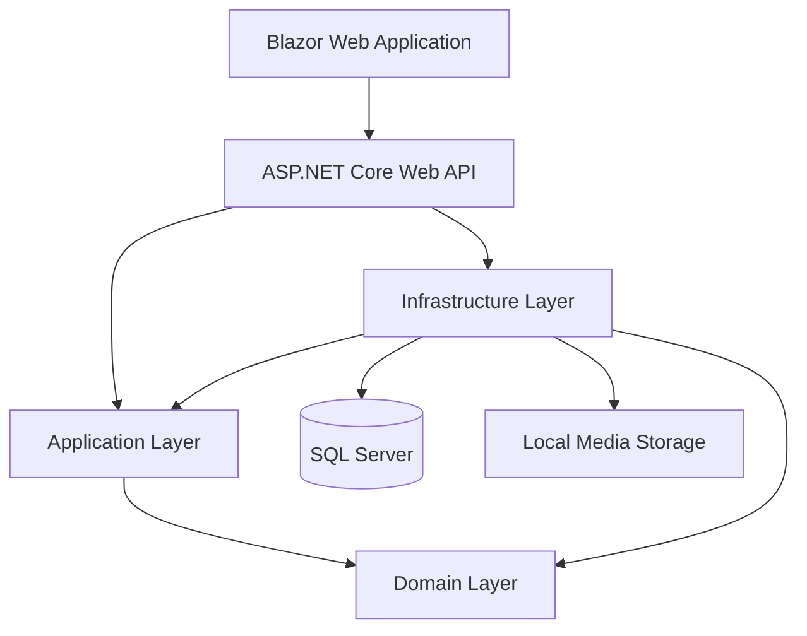

# DiveHub Management Platform

A full-stack scuba diving management platform designed to combine dive center operations, customer reservations, content management and digital services within a unified software ecosystem.

Built with .NET 10, ASP.NET Core Web API, Blazor, Entity Framework Core and Microsoft SQL Server.


## Project Overview

DiveHub Management Platform is designed around the operational requirements of real-world scuba diving centers.

The platform provides a public website, a customer portal, an administration panel and an independent backend API.

Its long-term objective is to evolve into a comprehensive diving management and marketplace ecosystem supporting web and mobile applications.

## Current Features

### Public Website

- Dynamic homepage and dive center information
- Diving activity catalog
- Scuba diving course catalog
- Dive site directory
- Instructor profiles
- Photo galleries
- Activity pricing and requirements
- Responsive user interface

### Customer Portal

- Customer registration and authentication
- Online reservation requests
- Reservation history
- Reservation status tracking
- Customer dashboard
- Contact preferences
- Reservation approval and rejection notifications
- Unread notification counter

### Reservation Management

- Administrative reservation approval
- Reservation rejection with an explanation
- Participant capacity validation
- Boat assignment
- Instructor assignment
- Daily resource availability checking
- Prevention of duplicate resource assignments
- Automatic reservation price calculation
- Minimum advance booking requirement
- Multiple currency support

### Administration

- Administration dashboard
- Website content management
- Activity and course management
- Dive site management
- Instructor management
- Boat management
- Reservation management
- Photo upload and management
- Content publication controls
- Resource activation and deactivation

### Boat and Instructor Management

- Boat registration
- Boat passenger capacity
- Instructor profiles
- Certification information
- Instructor profile photographs
- Daily availability validation
- Prevention of scheduling conflicts

## Business Rules

The reservation system implements operational rules designed for scuba diving centers:

- Reservations require administrator approval.
- Reservations must satisfy the minimum advance booking period.
- Participant numbers cannot exceed activity capacity.
- Boat capacity must accommodate the reservation.
- Activities requiring a boat cannot be confirmed without a boat assignment.
- An instructor must be assigned before confirmation.
- Boats and instructors cannot be assigned to multiple confirmed reservations on the same day.
- Customers receive notifications when reservations are approved or rejected.

## Technology Stack

| Technology | Purpose |
|---|---|
| C# | Primary programming language |
| .NET 10 | Application framework |
| ASP.NET Core | Backend infrastructure |
| Minimal APIs | REST API endpoints |
| Blazor | Web frontend |
| Razor Components | User interface components |
| Entity Framework Core | Object-relational mapping |
| Microsoft SQL Server | Relational database |
| ASP.NET Core Identity | User authentication |
| Bearer Authentication | API authentication |
| Cookie Authentication | Web authentication |
| Magick.NET | Image processing |
| HTML5 | Web structure |
| CSS3 | Custom responsive styling |

## Software Architecture

The solution follows a layered architecture that separates domain models, application contracts, infrastructure, backend endpoints and presentation concerns.



The independent API provides a foundation for future mobile applications and additional clients.

## Project Structure

```text
DiveHub-Management-Platform/
│
├── DiveHub.slnx
├── dotnet-tools.json
├── README.md
│
└── src/
    ├── DiveHub.Domain/
    ├── DiveHub.Application/
    ├── DiveHub.Infrastructure/
    ├── DiveHub.Api/
    └── DiveHub.Web/
```

### Solution Layers

| Project | Responsibility |
|---|---|
| DiveHub.Domain | Domain entities and enumerations |
| DiveHub.Application | Application contracts and business rules |
| DiveHub.Infrastructure | Database access, services and media storage |
| DiveHub.Api | REST API, authentication and authorization |
| DiveHub.Web | Public website, customer portal and administration |

## Database

The application uses Microsoft SQL Server with Entity Framework Core Code First migrations.

The current database model includes:

- Application users
- Identity roles
- Site settings
- Dive sites
- Activities and courses
- Boats
- Staff members
- Reservations
- Media assets
- Customer notifications
- Dive event entities

Database schema changes are managed through EF Core migrations.

## Authentication and Security

The application includes:

- ASP.NET Core Identity
- Secure password hashing
- Password complexity requirements
- Account lockout protection
- Role-based authorization
- API bearer tokens
- Secure authentication cookies
- Anti-forgery protection
- Authentication rate limiting
- Server-side input validation
- Protected administrative endpoints
- Database concurrency protection
- Image upload validation
- External media storage
- Environment-based secret configuration

### User Roles

| Role | Responsibility |
|---|---|
| Admin | System administration and operational management |
| Customer | Reservations, account access and notifications |
| Instructor | Reserved role for future instructor functionality |

## REST API

The backend exposes endpoints for public content, authentication, reservations and administrative operations.

### Selected Endpoints

| Method | Endpoint | Description |
|---|---|---|
| GET | `/health` | API health check |
| GET | `/health/db` | Database connectivity |
| POST | `/api/auth/register` | Customer registration |
| POST | `/api/auth/login` | Authentication |
| GET | `/api/auth/me` | Authenticated user |
| GET | `/api/public/activities` | Published activities |
| GET | `/api/public/dive-sites` | Published dive sites |
| GET | `/api/public/instructors` | Published instructors |
| GET | `/api/public/bookable-activities` | Bookable activities |
| POST | `/api/reservations` | Create reservation |
| GET | `/api/reservations/mine` | Customer reservations |
| GET | `/api/admin/reservations` | Manage reservations |
| GET | `/api/customer/notifications` | Customer notifications |

## Getting Started

### Prerequisites

- .NET 10 SDK
- Microsoft SQL Server
- Git
- Visual Studio or Visual Studio Code

### Clone the Repository

```powershell
git clone https://github.com/hakanberat/DiveHub-Management-Platform.git

cd DiveHub-Management-Platform
```

Repository access is required while the repository remains private.

### Restore and Build

```powershell
dotnet restore
dotnet build .\DiveHub.slnx
```

### Environment Configuration

Local configuration files and credentials are excluded from source control.

Configure the following environment variables before starting the API:

```powershell
$env:ASPNETCORE_ENVIRONMENT = "Development"

$env:ConnectionStrings__DiveHub = "Server=localhost;Database=DiveHubFullStack;Integrated Security=True;TrustServerCertificate=True"

$env:MediaStorage__Root = "C:\DiveHubData\Media"

$env:DiveCenter__TimeZoneId = "Asia/Nicosia"
```

Adjust the SQL Server connection string to match your local SQL Server instance.

The example connection string is intended for local development only.

### Database Initialization

For a new development database, initialize the database and create the first administrator:

```powershell
$env:BootstrapAdmin__Email = Read-Host "Admin email"

$securePassword = Read-Host "Admin password" -AsSecureString

$env:BootstrapAdmin__Password = [System.Net.NetworkCredential]::new("", $securePassword).Password

dotnet run --project .\src\DiveHub.Api --no-build --no-launch-profile -- --seed-admin

Remove-Item Env:BootstrapAdmin__Password
Remove-Item Env:BootstrapAdmin__Email
```

The bootstrap command applies database migrations, creates the initial Identity roles and registers the administrator.

This command is intended for initial development setup. It does not promote existing accounts.

### Run the Backend API

```powershell
dotnet run --project .\src\DiveHub.Api --no-build --no-launch-profile --urls http://localhost:5080
```

### Run the Blazor Frontend

Open a separate terminal:

```powershell
$env:ASPNETCORE_ENVIRONMENT = "Development"

$env:ApiBaseUrl = "http://localhost:5080/"

dotnet run --project .\src\DiveHub.Web --no-build --no-launch-profile --urls http://localhost:5081
```

### Local Application URLs

| Application | URL |
|---|---|
| Public Website | http://localhost:5081 |
| Administration | http://localhost:5081/admin |
| Administrator Login | http://localhost:5081/login |
| Customer Login | http://localhost:5081/customer/login |
| Customer Registration | http://localhost:5081/customer/register |
| Diving Activities | http://localhost:5081/activities/diving |
| Diving Courses | http://localhost:5081/activities/courses |
| REST API | http://localhost:5080 |
| API Health Check | http://localhost:5080/health |

## Development Roadmap

### Reservation and Operations

- [ ] Reservation cancellation
- [ ] Reservation completion management
- [ ] Customer profile management
- [ ] Operational calendar
- [ ] Instructor portal
- [ ] Event management

### Business Management

- [ ] Equipment inventory
- [ ] Equipment maintenance tracking
- [ ] Income and expense management
- [ ] Payment recording
- [ ] Multi-currency financial reporting
- [ ] Business analytics

### Marketplace

- [ ] Multiple dive center support
- [ ] Dive center owner accounts
- [ ] Dive center application and approval workflow
- [ ] Advanced search and filtering
- [ ] Multi-tenant architecture

### E-Commerce

- [ ] Diving equipment store
- [ ] New and second-hand equipment listings
- [ ] Product inventory
- [ ] Shopping cart
- [ ] Order management

### Mobile Applications

- [ ] .NET MAUI application
- [ ] Android and iOS support
- [ ] Mobile reservation management
- [ ] Digital diving logbook
- [ ] Push notifications
- [ ] API integration

### Software Quality and Deployment

- [ ] Unit tests
- [ ] Integration tests
- [ ] Automated smoke tests
- [ ] Docker containerization
- [ ] CI/CD pipelines
- [ ] Production deployment
- [ ] Monitoring and logging improvements

## Project Status

**Active development**

The current version focuses on single-center dive operations, customer reservations, resource management and website content administration.

Additional business modules, marketplace functionality and mobile applications are planned for future releases.

## Developer

**Hakan Berat Demircan**

- Full-Stack Software Developer
- PhD in Tourism Management
- Master's Degree in Information Technology
- Bachelor's Degree in Information Technology
- PADI IDC Staff Instructor
- Former Dive Center Co-owner and Manager

This project combines software development, tourism management and practical scuba diving industry experience.

[GitHub Profile](https://github.com/hakanberat)
